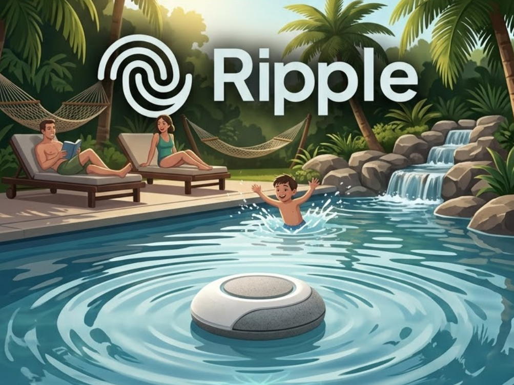

# Ripple — Smart Pool Fall Detection Buoy

<p align="center">
  
</p>

> **Boia inteligente de segurança para piscinas com detecção inercial de quedas, alertas de emergência nativos sem aplicativo via BLE Pop-ups, console sem fio e atualização de firmware Over-The-Air (BLE OTA).**

---

## 1. Visao Geral do Projeto

O **Ripple** e um dispositivo embarcado autônomo projetado para monitorar a superficie de piscinas e detectar quedas acidentais de pessoas ou animais de estimacao atraves de perturbacoes hidrodinamicas.

### Caracteristicas Principais
- **Design 100% Selado:** Opera hermeticamente fechado, alimentado por bateria LiPo, sem conectores externos ou botoes acessiveis apos o fechamento.
- **Deteccao Inercial de Ondas:** IMU de 6 eixos (acelerometro e giroscopio) monitorando oscilacoes bruscas de aceleracao e velocidade angular na agua.
- **Alertas Nativos Sem Aplicativo:** Multiplexacao de pacotes *Raw BLE Advertisement* simulando protocolos de proximidade (Apple Continuity, Google Fast Pair e Samsung Galaxy) para acionar notificacoes e pop-ups diretamente em smartphones proximos.
- **Monitoramento e Protecao de Bateria:** Leitura em tempo real calibrada via ADC1 com suporte a tensao minima segura configuravel via NVS. Corte automatico para modo *Deep Sleep* ao atingir 0% para protecao quimica da celula LiPo.
- **Atualizacao e Manutencao Sem Fios:** Firmware atualizavel via BLE OTA em alta velocidade (~5s) e console de telemetria/logs sem fio via Nordic UART Service (NUS).

---

## 2. Hardware e Pinout

- **SoC:** Espressif **ESP32-S3FH4R2** (Dual-Core Xtensa LX7 @ 240 MHz, 4 MB Flash, 2 MB PSRAM).
- **Placa de Desenvolvimento:** TENSTAR ROBOT TS-ESP32-S3 (`ESP32S3-1.14TFT`).

| Periferico / Sinal | Pinos / Endereco | Funcao / Descricao |
| :--- | :---: | :--- |
| **`TFT_I2C_POWER`** | **GPIO 21** | Chaveamento de alimentacao dos sensores I2C e display |
| **`NEOPIXEL_POWER`** | **GPIO 34** | Chaveamento de alimentacao do LED RGB WS2812 |
| **`I2C_SDA` / `I2C_SCL`** | **GPIO 42 / 41** | Barramento I2C principal (400 kHz) |
| **`QMI8658C`** | **`0x6B` (I2C)** | IMU 6-Eixos: Acelerometro ($\pm 4g$) e Giroscopio ($\pm 512^\circ/\text{s}$) |
| **`BMP280`** | **`0x77` (I2C)** | Sensor interno de pressao barometrica e temperatura |
| **`Bateria`** | **ADC1 Ch3 (GPIO 4)** | Leitura de tensao LiPo com divisor resistivo 100k/100k calibrado por eFuse |
| **`WS2812 RGB`** | **GPIO 33** | LED enderecavel de status do sistema e indicacao de bateria |
| **`LED Vermelho`** | **GPIO 13** | Indicador visual de alerta de emergencia |

---

## 3. Arquitetura de Firmware

- **Framework:** ESP-IDF v6.1 (FreeRTOS)
- **Pilha Bluetooth:** Apache NimBLE (suporte simultaneo a modo periferico NUS/OTA e transmissao broadcaster)
- **Esquema de Particoes Dual-OTA com Rollback:**
  - `otadata` (8 KB): Ponteiro de particao ativa e diagnostico de boot
  - `ota_0` (1.90 MB): Slot de aplicacao A
  - `ota_1` (1.90 MB): Slot de aplicacao B
  - *Rollback Anti-Bricking:* Reversao automatica para a particao estavel anterior caso um novo firmware falhe na inicializacao.

---

## 4. Ferramenta CLI Bluetooth (`tools/ripple_bt_cli.py`)

A comunicacao com a boia e realizada atraves da ferramenta CLI em Python baseada na biblioteca `bleak`:

```bash
pip install bleak
```

### Modos de Execucao

1. **Shell Interativo (Recomendado para operacao manual):**
   Inicia uma sessao persistente no terminal com comandos continuos e auto-descoberta:
   ```bash
   python tools/ripple_bt_cli.py
   ```
2. **Comando Direto (One-Shot / Scripts de Automacao):**
   Executa um comando especifico e encerra a conexao imediatamente:
   ```bash
   python tools/ripple_bt_cli.py <comando> [opcoes]
   ```
   > **Dica:** Utilize `-m <MAC>` ou `--mac <MAC>` para direcionar comandos diretamente a uma boia especifica sem prompts de selecao.

### Comandos Principais

| Comando | Descricao |
| :--- | :--- |
| **`help`** | Exibe a documentacao completa e lista de parametros de todos os comandos |
| **`dash`** / **`dashboard`** | Painel TUI interativo com graficos em tempo real de ondas (50 Hz) e perfil de bateria |
| **`ota <arquivo.bin>`** | Realiza a atualizacao completa de firmware via BLE OTA (~5 segundos) |
| **`ota-info`** | Consulta a particao em execucao, proxima particao de boot e versoes |
| **`battery`** | Consulta a tensao atual, porcentagem e parametros de protecao da bateria |
| **`set-bat-min <V>`** | Configura a tensao de corte seguro (0%) persistida em NVS |
| **`logs`** / **`log on/off`** | Streaming de logs do ESP-IDF sem fio via conexao Bluetooth |
| **`cmd <instrucao>`** | Envia comandos NUS (`status`, `sens <val>`, `test_alert`, `rearm`, `calibrate`, `sleep`, `reboot`, `rollback`) |
| **`scan`** / **`connect`** / **`disconnect`** | Gerenciamento manual de conexoes BLE |

> Para consultar a sintaxe detalhada de cada comando, execute:
> ```bash
> python tools/ripple_bt_cli.py help
> ```

---

## 5. Compilacao e Gravacao de Firmware

Para desenvolvedores e automações com agentes de IA (regras de sandbox, resolução dinâmica de ambiente e parâmetros locais), consulte o guia em [`AGENTS.md`](AGENTS.md).

### Compilar o Firmware
Com o ambiente ESP-IDF ativo no terminal:
```bash
idf.py build
```

### Gravar via BLE OTA (Recomendado — Boia Selada)
Para dispositivos já montados na piscina ou alimentados por bateria:
```bash
python tools/ripple_bt_cli.py ota build/ripple.bin
```

### Primeira Gravacao via USB (Bancada)
Em placas virgens ou durante montagem inicial em bancada, a gravação é feita via cabo USB. Como o circuito de USB-Serial/JTAG nativo do ESP32-S3 retém o estado de bootloader, utilize o reset via RTC Watchdog para iniciar a aplicação sem necessidade de pressionar o botão físico `RST`:
```bash
idf.py -p <PORTA_SERIAL> flash
python -m esptool --chip esp32s3 -p <PORTA_SERIAL> --after watchdog-reset read-mac
```

---

## 6. Aplicativo Mobile

O ecossistema **Ripple** possui aplicativo complementar para smartphone para configuracao e recebimento de alertas:
- Repositorio oficial: [victor-torres05/ripple-app](https://github.com/victor-torres05/ripple-app)
